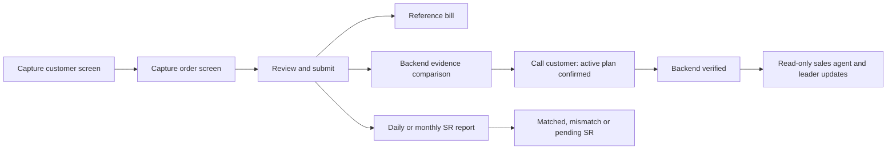

# Qanawat operations update — build 83

This guide describes the implemented operating rules and how to use the updated screens. It is not a deployment certificate or a claim that every device, external service or possible edge case has been tested. Release identity and completed verification should be recorded separately.

The optional payment receipt belongs to review/submit. SR reconciliation remains independent of backend evidence review; a mismatch does not erase the recorded external activation.

## Accounts and responsibilities

Client-facing names are **Super admin**, **Admin**, **Sales agent**, **Team leader**, **Backend verification**, **Tele-verification** and **Welcome calls**. Existing internal role identifiers and accounts remain compatible; changing the display name does not create a new account or transfer its history.

| Role | Main responsibility and limits |
| --- | --- |
| Super admin | Manage accounts, supported role permissions, branches, staffing and operational records. Permanent deletion of eligible managed records is restricted to this role; records linked to retained history are protected. Super admins cannot capture a new sale. |
| Admin | Manage daily operations, branch setup and authorized assignments, backend review, SR reconciliation, stock and final commission imports. Cannot create staff accounts, edit staff account identity, change role permissions or permanently delete managed records. Existing authorized operations capture access is retained. |
| Backend verification | Independently compare submitted customer/order evidence, record the customer active-plan call and complete backend review and SR reconciliation. Does not manage accounts or capture sales. |
| Tele-verification | Work the authorized tele-verification queue and record call outcomes. This is **not** a delivery-verification role. |
| Welcome calls | Work the authorized welcome-call queue after its prerequisites are met. |
| Sales agent | Capture and submit their own sales, use their own drafts and history, see their own commission amounts, and request field support. Cannot approve their own evidence or reassign staff. |
| Team leader | See authorized team activity and read-only backend confirmation updates, plus their own commission amounts. Cannot approve transactions, change staff assignments or see another person's commission simply because they supervise them. |
| Sales Manager | Read the authorized sales and performance views across all branches, including commission information. Read access does not grant operational editing or account control. |
| Branch Manager | See their authorized branch information. Branch visibility does not grant organization-wide access. |
| Inventory Manager | Manage authorized branch stock and assets. Does not gain backend review or account-management rights. |

Every action also requires its effective database permission. Hiding a button is not the access boundary: protected API routes enforce role, permission, account and branch rules. The Super admin's **Accounts & access** control can restrict supported role grants. Account/permission changes revoke affected sessions so the user must sign in again. It cannot grant arbitrary permissions beyond a role's supported maximum.

## Set up branches, team leaders and sales agents

1. Open **Branches** and add the branch. Its location is optional at this stage.
2. Open **Team leaders** and create the branch's leaders. A branch can have several leaders.
3. Open **Sales agents** and choose both the branch and the agent's designated team leader. The leader must belong to that branch.

These are separate forms. Adding or editing a leader does not silently reassign existing agents. Authorized management changes assignments explicitly, with a reason and a current record version. A sales agent retains their history after reassignment; a sale and its notification recipients retain the branch and leader saved when it was submitted. Current workforce location access follows the current authorized assignment rather than exposing a former assignment's GPS history.

Branch and staff Excel/CSV imports use downloadable templates and a preview before applying. Create/import branches first, leaders second and sales agents third. A staff import must refer to an existing branch and, for an agent, an existing leader in that branch. Branch imports are available to authorized operational management; staff-account imports require the Super admin. Files are limited to 50 rows and 2 MB. Invalid or conflicting rows reject the file; an exact repeat does not add duplicate records. Staff-password files must be kept private and shared securely.

The shared branch selection persists across pages within the signed-in account. It filters only records the role may already access. SR report reconciliation deliberately covers all branches in the selected reporting period, and its screen identifies that scope.

## Record a sale in the app or mobile web demo

1. **Customer:** capture or upload the external checkout customer-details screen. Review the parsed fields against the image.
2. **Order & plan:** capture or upload the order-details screen. Review the product, package, customer phone, request ID and charges actually shown. Supporting sale details remain available.
3. **Review & submit:** check the recorded information and optionally attach the payment receipt. Submission stores the sale and displays the compact animated **Reference bill**, with a direct **Home** action.

The new workflow has no separate payment-confirmation approval gate and no barcode/signature requirement. An optional stored receipt is a payment record; it is not independent proof of payment-gateway settlement. A request ID alone is an order confirmation and is not a payment method. Unknown values remain **Not recorded**.

OCR reads an explicitly printed SR from the order or optional receipt. If an SR was not captured, the agent can enter it manually in supporting details. The system records whether it came from evidence or manual entry. A request ID is not used as an SR fallback. Changing the captured order clears evidence associated with the previous order. Required evidence and readable customer/order fields are checked on the server as well as in the clients; manually typing details does not replace missing required capture evidence.

Drafts are saved in the signed-in agent's drafts. Starting a new transaction clears the previous form. The mobile web demo uses the same API as the portal: a submitted demo sale can be reviewed in the backend panel. Demo capture shortcuts are synthetic samples, not carrier or identity verification.

Request IDs, SRs and repeated order/receipt evidence have duplicate protections. Exact retries of an accepted operation are safe; conflicting repeated or concurrent submissions return an already recorded/processing message. Different legitimate orders for one customer remain possible.

## Independently verify the customer and active plan

Open **Backend verification**, choose the submitted sale and compare its original customer/order evidence with the recorded details side by side. The review offers a customer-phone calling link, a call outcome and a note.

- Record **Active confirmed** only after calling the customer and confirming that the plan is active.
- Record **Not active**, **No answer** or **Wrong number** with a meaningful note when appropriate. A saved call attempt leaves the sale awaiting review.
- Approval of a submitted screenshot sale requires **Active confirmed** and a meaningful call note, in addition to valid recorded intake. This also applies to earlier pending submissions of the same screenshot workflow.
- Return evidence for correction when it is wrong or unreadable. Cancelled sales cannot be revived by approving their evidence.

The reviewer must be an independent authorized user, not the submitter. The system records the outcome, note, phone, reviewer and time; it does not itself place a carrier call or establish that a human actually completed one. Team leaders receive the backend confirmation as a read-only update and have no additional approval step.

## Reconcile SR numbers with daily or monthly reports

Open **SR verification** and choose **Daily** with a sale date, or **Monthly** with a month. Download the template, upload Excel/CSV, inspect the preview and apply the checked reconciliation. A current-month report includes elapsed dates through today; future periods are rejected.

The comparison shows each recorded sale's SR, the report match or mismatch, its reason and the report status. Saved import history keeps the selected period and comparison results. A stale preview must be checked again before applying. Repeating an unchanged report is safe; a late sale or corrected SR can produce a new audited reconciliation.

Externally recorded activation and SR reconciliation are separate:

| Display | Meaning |
| --- | --- |
| Activated · pending SR verification | The external sale is recorded, but no matching report verification exists. |
| Activated · SR mismatch | The report comparison found a mismatch; inspect its saved reason and evidence. |
| Activated · pending backend review | SR matched, but independent evidence/customer-call review remains unfinished. |
| Fully activated | Independent backend confirmation and matched SR are both complete. |

A pending/mismatched SR does not erase the external activation. Report cancellation updates net totals on the sale's original date. Pending/mismatch alerts go to the salesperson and the leader saved on the sale, subject to access checks. Email alerts use a durable queue, but actual delivery requires configured SMTP sender and credentials; an in-app notification is not evidence of an email reaching the recipient's inbox.

## Calls and product details

NEW, MNP, P2P, HW and eLife use the tele-verification and welcome-call workflow. Tele-verification is due on the sale day; a documented technical deferral may extend it to the next day. Welcome calls require successful tele-verification and a closed sale, and are due within two days of the sale. External activation remains recordable; sequencing problems are flagged.

Home Wireless fulfilment options are **Delivery**, **On spot** and **Without router**. On spot requires a router serial. The valid fulfilment option called Delivery is separate from the rejected delivery-verification role.

Targets cover NEW, MNP, P2P, HW, ELIFE, WASEL and VISITOR. Missing category targets show **Not configured**. An explicit ALL target is used when present; otherwise configured product targets are summed without double-counting.

## Import final commissions without configuring estimates

**Incentives** opens with **Final commission amounts**. Authorized management can download its Excel template, fill the final approved amounts, preview the rows and apply them. Columns are:

`user_email`, `earned_on`, `amount`, `reference`, `note`.

Use an existing eligible sales agent, team leader or Sales Manager email, a non-future earned date, an AED amount with at most two decimals and a text reference. Imports allow 1–500 rows, up to 2 MB. Formula cells are rejected. The same person/date/reference cannot be recorded twice: exact repeats are recognized, while a different amount for an existing reference is rejected rather than silently replacing it. There is no final-amount adjustment screen in this update.

Filter recorded amounts by From/To date, authorized branch, person and assigned team leader. Branch/leader attribution is saved at import. Agents and leaders see their own amounts; authorized management and Sales Managers can read the permitted wider view. The primary total and dashboard final-commission figure sum imported final amounts only. Export final amounts as CSV, Excel or PDF, including through **Reports → Incentive tracking**.

**Calculated estimates and commission setup** remain separate and collapsed. Imported final amounts do not depend on configuring those estimates. Approved email table values remain available, while unknown eligibility, allocation, slab/profile mapping and other incomplete policy inputs remain **Awaiting configuration**. No new projection formula is invented.

CRR is net closed sales divided by elapsed calendar days in the reporting month. DRR is `(monthly target − net closed sales) / remaining calendar days`. With no days remaining, DRR is **Not available**; the supplied formula can produce a negative DRR after exceeding target. Cancelled sales are excluded from the original-date net totals.

## Branch stock, SIM inventory and support

Select the receiving branch before adding stock. **Assets & supplies** uses branch-owned stock, with a template and preview/apply Excel/CSV import. Its categories are Grabba device, router, stamp, ID card, uniform and other. Serialized items require quantity one; un-serialized supplies accept a positive whole quantity. The import allows 1–500 rows, up to 2 MB, and rejects formula cells, conflicting serials and repeated additions.

SIM inventory remains branch-scoped and includes the linked recorded SR where available. Inventory state and payment-record state remain distinct. Backend approval deducts a known matching branch SIM once; a missing serial never creates a fictional movement. Cancelling a used SIM does not automatically make it reusable: an authorized audited stock adjustment is required. Current screenshot sales also appear in **Activations**, alongside retained historical activation records.

Sales agents can reach **Need field support?** from their app home and **Support · ask for help** from their profile. They can submit a subject and description and inspect their authorized requests. Authorized support staff respond through the portal. Support does not grant account or transaction-review permissions.

## Optional branch location and work boundaries

**Add branch** includes **Add branch location and work radius**. Search for the real public worksite, drop a map pin, enter latitude/longitude, or deliberately use the device's current location; then choose its radius. The branch record can be edited later with a reason and current saved version. The permitted radius is 25–100,000 metres. No branch or member coordinates are invented.

This saves the branch boundary. Global **Outside boundary blocks work and sales** is a separate control in **Work locations** and remains off until real boundaries and assignments are configured. Individual member boundaries remain available in Work locations and do not change branch/leader assignments.

Members explicitly start a visible work session with device location permission. Collection stops when work ends or the user signs out, and does not continue while the app is hidden or closed. When enforcement is on, the server blocks shift starts and new sale captures/submissions without a valid assigned boundary, active session and sufficiently recent, accurate in-boundary point. Missing, stale, known mocked or uncertain readings do not prove that a member is inside.

Selecting a branch/member displays its assigned radius even without a live recorded position. Management sees only authorized current members. Location exports preserve the same scope and include the recorded location and boundary information. Signing out revokes the account session and attempts to close its active work session even when the access token has expired or the location grant has been withdrawn; a revoked session cannot continue posting positions.

Street maps and available 3D building coverage are attributed public maps. The optional satellite overview is **EOX Sentinel-2 cloudless 2016, 10-metre resolution**; it is not a live or guaranteed building-level view. External Google Maps/Street View links depend on coverage. Search or imagery failure leaves typed coordinates and pin/radius controls available. See [Work location rules](WORK-LOCATION.md) and the [location/SR guide](QANAWAT-WORK-LOCATIONS-AND-SR-GUIDE.md).

## Verification boundaries

Session renewal retains token rotation with a fixed ten-second recovery window for lost responses or concurrent refreshes. Retries reuse one encrypted replacement and do not extend that window. Revoked, expired or unauthorized accounts cannot use recovery. Client requests from an older login are discarded after account switching. Branch editors keep the snapshot they opened with, so live updates cannot silently authorize overwriting another person's edit.

- Web, mobile demo and Android use the same role-scoped backend. A web-only account/permission control need not have an identical native editing screen.
- Existing accounts, edited plans, historical sales and notification snapshots are preserved by these changes; this document does not authorize a production data reset.
- OCR requires readable supported evidence. It is not a promise of perfect extraction, document authenticity or resistance to every edited image. Users and independent reviewers must check extracted details.
- Geofencing uses device GPS evidence, not hardware attestation or a guarantee against sophisticated spoofing. Mapping/search providers have their own coverage and availability limits.
- SMTP configuration, actual recipient inbox delivery, unfinished commission-policy inputs and projection are independent outstanding items. Imported final commissions are usable without the unresolved estimate inputs.
- This guide does not claim physical paper-printer compatibility, iOS device testing, a production load certification or a completed deployment. Record those outcomes only after the relevant checks are run.
